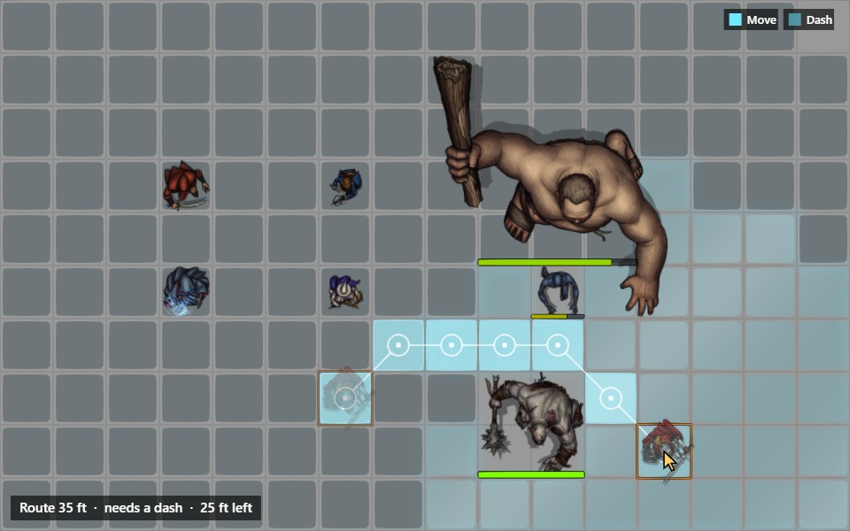
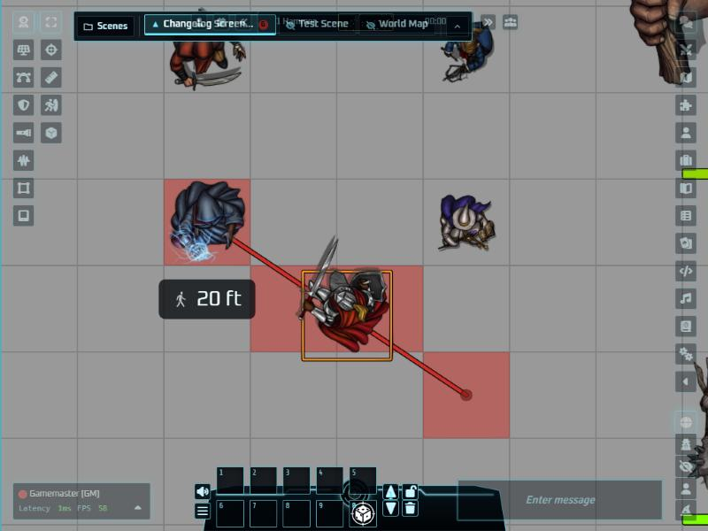
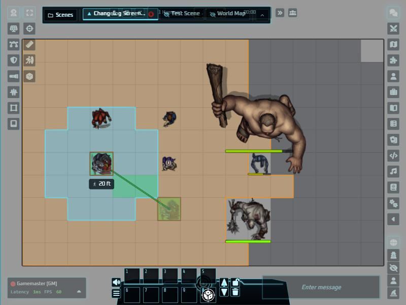
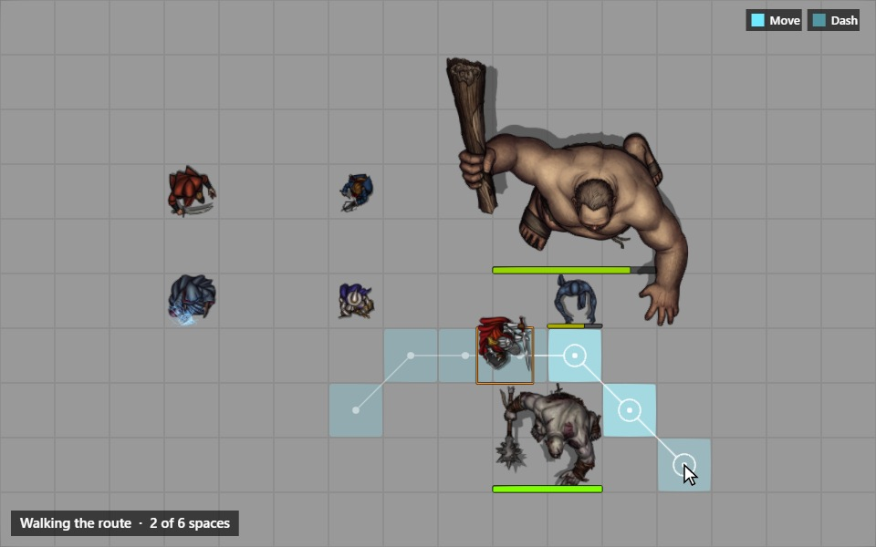
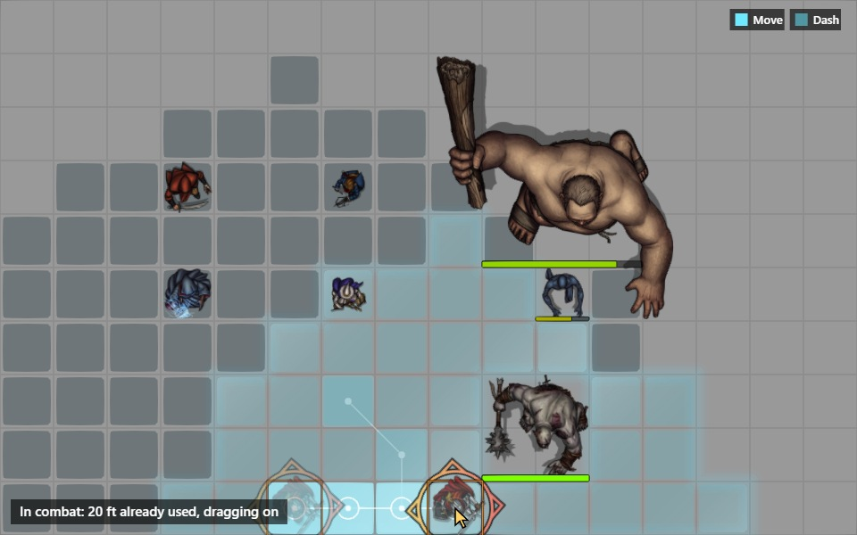
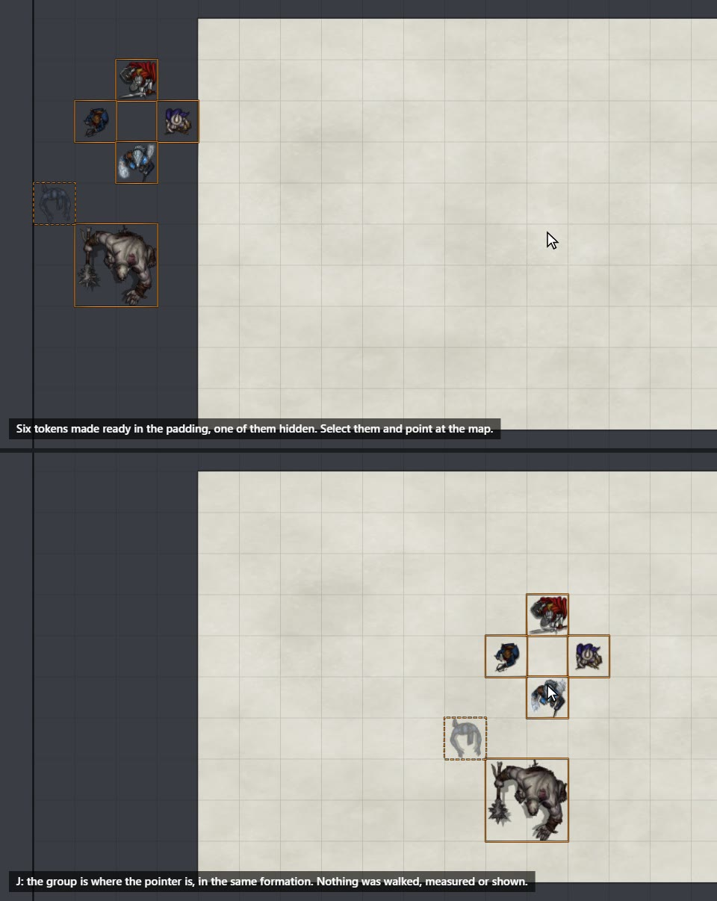
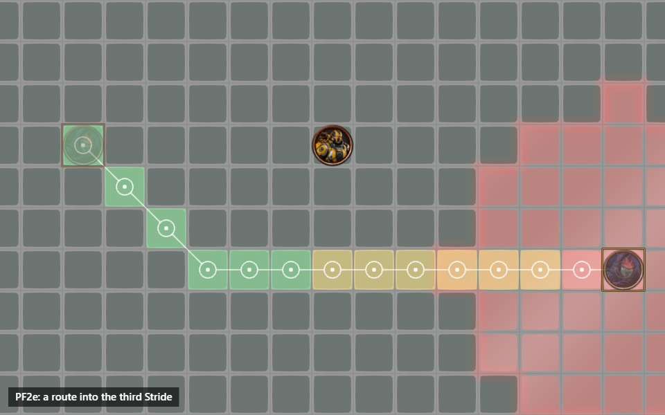
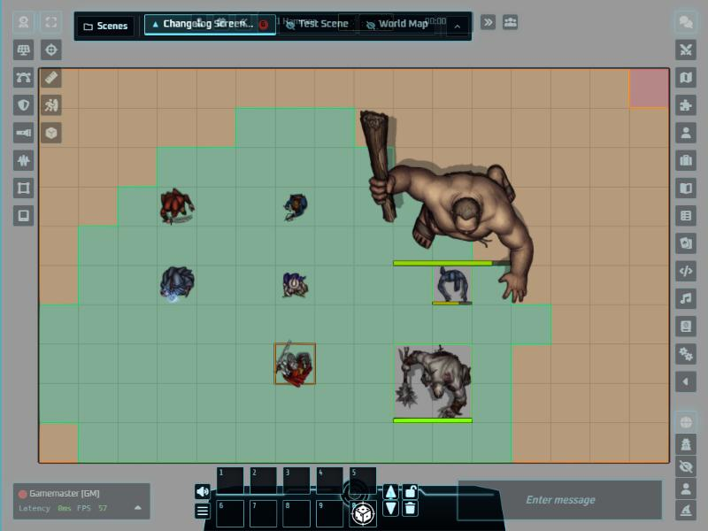
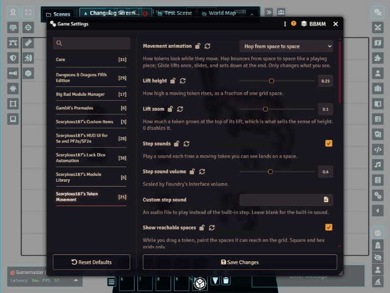
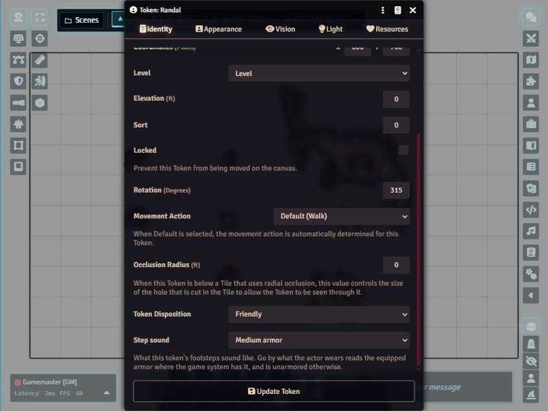

# Scorpious187's Token Movement

Makes moving a token feel like moving a miniature, on any game system, for Foundry VTT v14.

- **Lift and hop.** A moving token rises off the map, hops from space to space and lands. Or pick the glide: lift once, slide, set down.
- **Step sounds.** A footstep each time a token you can see lands on a space, and it sounds like what the token wears: cloth when unarmored, leather in light armor, leather and mail in medium, plate in heavy. Or one sound for everyone, or your own file. Large, Huge and Gargantuan tokens step lower, with more bass, and ring in the room.
- **Hooves and wings.** A horse gallops: hoofbeats in place of footsteps, for anything named as a hoofed animal. A dragon, a griffon or a bird is heard beating its wings, but only while its movement action is Fly. On the ground it walks like anything else.
- **Reachable spaces.** While you drag a token, the spaces it can get to light up as tiles with a soft glowing edge, in bands: its move, then a dash (or a second and third Stride in Pathfinder and Starfinder 2e). The route you are dragging is a lit strip with a ring on every step, and it stays under the token as it walks, dimming behind it.
- **A way round.** When the straight route is blocked, the cheapest route round is planned for you.
- **System-agnostic.** Speeds are read from a data path on the actor. Presets cover common systems; one setting covers the rest.
- **Your camera stays yours.** Nobody's movement moves anybody else's view. The one exception is a GM-only key the GM holds on purpose.
- **Teleport, for the GM.** One key puts the selected tokens down where the pointer is: no drag, no route, no walls in the way. A group keeps its formation.
- **Colours that suit the game.** With [Scorpious187's HUD UI](https://github.com/nscarpinatodev/scorpious187s-scifi-character-hud) active, the range takes its colour from the device you wear: one colour, bold nearest the token and darker and fainter with each band further out. Pathfinder and Starfinder 2e get green, yellow and red for the first, second and third Stride.



On video: [the range, the route and the walk in the Tiles style](docs/media/tiles-style.mp4), and [the walk on its own at quarter speed](docs/media/tiles-trail-slow.mp4).


The same walk as video: [hop at real speed, with step sounds](docs/media/walk-hop.mp4), [hop at quarter speed](docs/media/walk-hop-slow.mp4), [glide](docs/media/walk-glide.mp4). The frames are captured from the game canvas at 60 fps; the step sounds in the first video are the module's own files, placed at the frames where it plays them.



Inspired by [Aeris Tokens](https://gitlab.com/aeris-fvtt/aeris-tokens) by Robin Chand, which targets v12–v13. This is an independent implementation for v14 that shares no code or assets with it.

## How it differs: it sits on top of core

Foundry v13 and v14 gained real token movement: waypoints, a ruler that shows the route to everyone, movement actions, terrain cost, and a per-turn movement history. This module does not replace any of it.

| You see | Who does it |
| --- | --- |
| The distance labels, and the routes other players are planning | Core's token ruler (or your system's) |
| The lit route under your own drag, and the trail a token walks | This module, in the Tiles style. In the Flat style both are core's line and squares |
| A route around a wall | This module. Core on its own draws a straight route and stops it at the wall |
| Other players seeing your planned move | Core |
| Whether a step is blocked, and what it costs | Core and your system, asked one step at a time |
| The lift, the hop, the footfall | This module |
| The painted reachable area | This module |

Because every step is priced and tested by asking the token itself, the painted area agrees with what the system will actually allow. In D&D 5e that means spaces held by enemies are left out, and terrain is costed by dnd5e's own cost function, with no D&D-specific code here. Players are only shown spaces they have seen, and a wall only blocks their overlay once they have seen it, the same rule core uses for its path preview.

Nothing is sent over a module socket. Each client already animates every move, so each plays its own hop and its own footsteps.

It also reads Foundry's settings rather than assuming them. The diagonal rule is whatever **Square Grid Diagonals** is set to in the core settings, including Alternating (1/2/1) and (2/1/2), and under those the count carries across a turn the way core's ruler counts it: if a token has already taken one diagonal this turn, the next one is priced as the second. Unconstrained movement and token auto-rotate are core's and are left alone.

## While you drag

When a drag starts, the overlay shows everything the token could reach, and for a plain drag that is what it goes on showing until you let go. Wherever the pointer goes, Foundry plans the route there afresh from the start, so a space's colour always says what it costs to drag the token to it: back towards the start is a short move again, and is coloured as one.

Dropping a waypoint fixes the route up to it, and the overlay follows:

- It re-centres on the waypoint and shows what the movement left after it can still reach, in the same band colours. A band the route has used up drops out.
- Spaces that were reachable when the drag began but are not any more are dimmed, so you can see what the route so far has cost.
- Take the waypoint back and the range before it returns. Drop or cancel and it clears.

The route's cost is core's own figure, the same one on the ruler label, so the two always agree: waypoints, difficult terrain, the diagonal rule and movement already used this turn are all in it.



On video: [the range through a plain drag, then a waypoint](docs/media/live-drag.mp4).

## The look

There are two styles, chosen per user with **Range style**.

**Tiles** (the default) follows the look of Aeris Tokens:

- Every reachable space is its own tile, a little smaller than the space and with rounded corners, so the map's grid shows between them.
- Following the HUD, the whole range is one colour. The nearest band is the device's main colour, drawn bolder than the opacity setting; each band beyond it is 20% darker than the one before and fainter. A fine line runs between the tiles where one band gives way to the next.
- A soft glow runs round the outside of the whole area and pulses slowly. A faint shimmer drifts across the tiles. **Animate the range** turns both off for a still overlay.
- The route you are dragging is a brighter strip of tiles with a ring on each step and a line joining them. A step the system will not allow is tinted red.
- Spaces the route has put out of reach stay as dark tiles.
- When you drop the token the route stays where it is, in the same colour, and is used up as the token walks: each step it reaches dims to a faint tile with a dot, and the rings ahead wait for it. Out of combat the trail goes when the walk ends.
- In combat, where Foundry keeps this turn's movement, hovering a token or holding Alt shows its turn so far in the same faint tiles, and a new drag carries on from the end of them.





Every step of a route is drawn in the colour of the band its distance falls in, so the route itself shows where the move ends and the dash begins: in D&D the first 30 ft of a speed-30 route are in the move colour and the rest in the dash shade; in Pathfinder the first Stride's worth is green, the second yellow and the third red. The route's tiles are a lighter, brighter version of those colours so they stand out of the range, and each step keeps its colour when the route becomes the trail.

For these routes Foundry's own line, waypoint dots and highlighted squares are hidden, so nothing is drawn twice. Foundry still decides what is on a trail, when it is shown and who sees it, and its distance labels stay. Untick **Light up the route** to keep Foundry's ruler as it is and have tiles for the range alone.

**Flat** is a plain tint with a hard outline round each band, under core's ruler. The screenshots further down this page that show a thick route line were taken in it.

The tiles are drawn with this module's own geometry on square and hex grids; nothing is taken from Aeris Tokens but the idea.

## Finding a way round

Foundry has a hook for pathfinding but no pathfinder: left alone, a drag is a straight line that stops at the first wall. This module fills the hook in.

- If the straight route gets where you are dragging and nothing on it costs extra, it is the route. On open ground the spaces and the cost are what they always were.
- If it is stopped short, the cheapest route round is searched for and its corners are added to the route as waypoints. The ruler, the cost and the live range all follow.
- If it gets there but crosses something that costs extra, such as difficult terrain or, in D&D 5e, the space of a creature you can squeeze past, a cheaper route is taken when there is one. So the cost on the ruler is always the cost the range overlay shows for that space. Place a waypoint of your own on the way to go through anyway.
- The token walks the spaces the route shows. Core draws and prices a leg as the staircase of spaces under it but slides the token along the straight line between its ends; here every turn of the staircase is a waypoint, so the token goes from space to space as drawn.
- "In the way" means whatever your game system says blocks a step, so in D&D 5e the route goes round enemies as well as walls.
- A player's route is only bent by walls they have seen, the same rule core applies to its own preview.
- If there is no way round within reach, you get core's answer: the route stops at the obstacle.
- The route is worked out on the spot, in about a millisecond once a drag is under way, so the route and the range keep up with the pointer as it crosses each space. Nothing waits on a search.
- Waypoints you place yourself are kept; each leg between them is routed on its own.

The search can be switched off per user with **Find a way round**, which you will want if another module does your pathfinding. If such a module is already answering, this one stands aside. Switched off, routes are core's straight ones, still walked space by space.


On video: [dragging behind a wall and walking the route](docs/media/pathfinding.mp4). And [a three-action move in Pathfinder 2e](docs/media/pf2e-three-actions.mp4): 90 ft, three Strides, round a wall. The wall line is drawn onto the video; walls are not visible on the token layer in play.

## Whose camera moves

A player moving a token never pans, zooms or otherwise pulls anyone else's view. There is no setting for it.

The GM has one tool: hold **G** while moving tokens and every player's view pans to follow that move, framing the whole group if several tokens moved together. Let go and moves are private again.

- The key is GM-only in Foundry's Controls and cannot be bound or triggered by a player.
- Each client checks that the move really came from a GM before following. A player who forged the request would be ignored.
- Hidden tokens are never followed, so the GM can hold the key through a mixed move without revealing anything.
- The GM's own view is not moved.

## Teleport

For setting a scene. Make a token ready where the players are not looking, out in the padding round the map: hide it, or whatever else it needs. Then select it, point at the space it belongs on and press **J**. It is there.



- **GM only.** The key is GM-only in Foundry's Controls and cannot be bound or triggered by a player, and the API call does nothing for one.
- **Nothing is walked.** No route, no ruler, no trail, no hop and no footsteps. Walls and terrain are not in the way and no movement is spent, in combat or out. It is core's own displace action, the one behind undo and cut and paste.
- **A group lands as a group.** Select several tokens and the middle of the selection goes to the pointer. Every token keeps its place round it, on a space of its own, whatever the sizes, on square and hex grids.
- **On the grid**, unless you hold **Shift**: then the selection is centred on the pointer to the pixel. On a gridless scene it always is.
- **Ctrl+Z** takes it back.
- **Kept on the canvas.** A group put down at the edge is slid back on whole, not squeezed.
- **Hidden stays hidden, and locked stays put.** Nobody's view moves either. To bring the players along, hold **G** as you press it, as with any other move.
- **With Token Mounting**, teleporting a rider teleports its mount, and the mount takes everyone on it.

The pointer has to be over the map. Over a sidebar or a window the key says so and moves nothing.

## With Token Mounting

[Scorpious187's Token Mounting](https://github.com/nscarpinatodev/scorpious187s-token-mounting) puts tokens on other tokens. When it is active (0.6.0 or later for all of this):

- **Dragging the rider who steers is dragging the mount.** Token Mounting hands the drag to the mount, so the range, the route and the cost you see are the mount's own: its speed, what it has left this turn, a route planned for a token of its size.
- **A passenger gets no range.** They go nowhere until they dismount, so their drag is left to Foundry's own ruler.
- **Riders rise and fall with the mount.** When the mount hops, whoever is on it goes up with it. Only the mount makes footsteps.
- **Being carried leaves no trail.** A rider's trail shows only what it walked itself.

With Token Mounting 0.5.0, which drags the rider as its own token, the range shown is still the mount's, but the route is planned for the rider's space.

On video, a rider and then two riders on a horse: [mounted-movement.mp4](docs/media/mounted-movement.mp4).

## Requirements

- Foundry VTT v14
- [Scorpious187's Module Library](https://github.com/nscarpinatodev/scorpious187s-lib)

No libWrapper or socketlib needed.

## Install

In Foundry's setup screen, choose Add-on Modules, then Install Module, and paste this into Manifest URL:

```
https://github.com/nscarpinatodev/scorpious187s-token-movement/releases/latest/download/module.json
```

Foundry installs the Module Library with it.

## Speeds

The range overlay needs to know how fast a token is. Out of the box:

| System | Reads | Bands |
| --- | --- | --- |
| D&D 5e (`dnd5e`) | `system.attributes.movement.speeds.{action}` | move, dash |
| Pathfinder 2e (`pf2e`), Starfinder 2e (`sf2e`) | `system.movement.speeds.{action}` | 1, 2, 3 Strides |
| Pathfinder 1e (`pf1`), 3.5e (`D35E`) | `system.attributes.speed.{action}.total` | move, dash |
| Starfinder 1e (`sfrpg`) | `system.attributes.speed.{action}.value` | move, dash |
| Level Up A5E (`a5e`) | `system.attributes.movement.{action}.distance` | move, dash |
| Savage Worlds (`swade`) | `system.pace` (in grid spaces) | move, dash |

`{action}` is the token's current movement action (walk, fly, swim…). If the token has no speed for that action, its walking speed is used. The dnd5e, pf2e, sf2e and D35E paths were checked against the installed systems; the others follow each system's published data model.

For any other system, set **Speed data path** in the module settings, and **Speed is measured in** if the system counts in squares rather than feet or metres. **Fallback speed** covers tokens with no actor.

In combat, the range shrinks by what the token has already moved this turn, using core's movement history.

## Controls

- **Drag a token** to see its range. It clears when you drop or cancel.
- **M** (rebindable) pins or unpins the range of the selected token without dragging. A pinned range follows the token and redraws when walls, turns or settings change.
- **G** (GM only, hold, rebindable) brings every player's view along with the tokens you move.
- **J** (GM only, rebindable) teleports the selected tokens to the pointer. With **Shift**, off the grid.


## Colours

**Colour scheme** has three choices, per user.

**Suit the game system** (the default):

- Pathfinder 2e and Starfinder 2e get green, yellow and red for the first, second and third Stride, in either style.
- Every other system matches your Character HUD, as below.



**Match my Character HUD** takes the colour from the device you wear and re-colours the moment you change device. The colours are read from the HUD at draw time, so new devices and looks need nothing from this module.

- In the **Tiles** style everything is a shade of one colour, the one the HUD gives the first band (the device's main colour): the bands, the lit route, the trail, the glow, and a trace of it in the dark tiles a route has cost. The nearest band is bold and each one further out is 20% darker and fainter.
- In the **Flat** style the nearest band uses the device's main colour, the second its accent and the third its warning colour.

**My own colours** uses the three colour pickers, one per band, in either style. They are also what you get if the HUD is not active.



## Settings

Per user: find a way round (pathfinding) on or off, animation style (hop, glide, or Foundry default), lift height and zoom, step sounds on or off, their volume (they play on Foundry's Interface audio channel), which footsteps you hear (matched to each token, one armor class for everyone, or the original tap) and whether big creatures sound big, whether to show reachable spaces, range style (tiles or flat), animate the range, light up the route, colour scheme, band colours and opacity.

Per world: walk speed (how fast tokens travel, in spaces per second; Foundry's own is 6), custom step sound, speed data path and unit, fallback speed, range bands (for example `1, 2, 3`), subtract movement already used, only show in combat, and the largest range to draw.



Per token: Step sound and Flight sound, on the Identity tab of Token Configuration. Step sound says what that token's steps sound like when the actor has no armor to read, which is most monsters and NPCs, or that it walks on hooves when its name does not say so. Flight sound gives a token wingbeats or takes them away. Eight steps of each set, unarmored through heavy: [armor-steps.mp3](docs/media/armor-steps.mp3). And how size changes them, six steps each at ordinary size, Large, Huge and Gargantuan, first unarmored and then in heavy armor: [size-steps.mp3](docs/media/size-steps.mp3). Both on video, with tokens walking in Foundry: [step-sounds.mp4](docs/media/step-sounds.mp4).



### Hooves and wings

What a creature is goes by its name, the token's or its actor's, because no game system says which creatures have hooves or wings. Names are matched as whole words: "Riding Horse" and "Warhorse" are horses, "Horseshoe Crab" is not.

- **Hooves:** horse, warhorse, steed, pony, mule, donkey, stallion, mare, destrier, pegasus, unicorn, nightmare, centaur, zebra, elk, stag, deer, moose, reindeer, ox, bison, aurochs. Their steps are one stride of a gallop, three hoofbeats, on every third space or so. It starts on a landing, so it keeps time with the token, and waits out its own length before it starts again, so the gallop keeps its pace whatever the walk speed.
- **Wings:** dragon, wyrmling, wyrm, drake, wyvern, griffon (griffin, gryphon), hippogriff, pegasus, roc, phoenix, eagle, hawk, falcon, owl, raven, crow, vulture, bird, bat, harpy, manticore, chimera, peryton, gargoyle, sphinx, couatl, pteranodon, pterosaur, angel, deva. A wingbeat about once a second, and only while the token's movement action is Fly. A dragon walking makes its footsteps and no wing sound. A creature with no wings flies in silence, as before: a wizard under a Fly spell does not flap.

A creature the lists miss, or get wrong, is set in Token Configuration. Hoofbeats and wingbeats are recordings of something Large already, so "big creatures sound big" leaves a Large horse as recorded and starts lowering them at Huge.

On video, in Foundry: a ridden horse, then a dragon walking and flying: [hooves-and-wings.mp4](docs/media/hooves-and-wings.mp4).


## For module and system authors

```js
// Replace the bands for a token. Distances are in scene units.
Hooks.on('scorpious187s-token-movement.getMovementRanges', (tokenDocument, action, ranges) => {
  if (tokenDocument.actor?.statuses.has('grappled')) ranges.push({ distance: 5, color: 0xff0000 });
});

// Say what a token's steps sound like: 'unarmored', 'light', 'medium' or 'heavy'.
Hooks.on('scorpious187s-token-movement.getArmorClass', (tokenDocument, result) => {
  if (tokenDocument.actor?.type === 'vehicle') result.armor = 'heavy';
});

// Fired on every client each time an animated token lands on a space. `sound` is what the
// landing sounds like, {src, size, kind}, or null when it has no sound of its own: a token
// that glides, or a space in the middle of a horse's stride.
Hooks.on('scorpious187s-token-movement.step', (token, index, sound) => {});

const api = game.modules.get('scorpious187s-token-movement').api;
api.getSpeed(token, 'walk');          // scene units, 0 if unknown
api.getMovementRanges(token, 'walk'); // [{distance, color, alpha}]
api.getArmorClass(token);             // 'unarmored' | 'light' | 'medium' | 'heavy'
api.getStepClass(token);              // the same, or 'hooves'
api.hasWings(token);                  // whether it is heard flapping when it flies
api.getMovementSound(token, 'fly');   // {kind, sources, every, size} for an action, or null for silence
api.getStepSounds(token);             // the files this token's steps on foot are drawn from
api.getStepWeight(token);             // 'large' | 'huge' | 'gargantuan', or null for a step played as it is
api.pinRange(token);                  // or api.pinRange() to unpin
api.refreshRange();
api.rangeSnapshot();                  // what the overlay shows now, as plain data; null if nothing
api.trailSnapshot(token);             // the trail drawn for a token: steps, how many walked; null if none
await api.teleportTokens(tokens, { x, y });  // GM only: put tokens down round a point; add { snap: false } to land off the grid
```

Flying, swimming, burrowing and driving glide rather than hop and make no footsteps; flying is where wings are heard. Teleports and unmeasured movement (a rider carried by its mount, a displacement) get no arc and no footsteps of their own, and a movement action marked as not visualized leaves no trail.

## Not yet

- Gridless scenes get the animation but no range overlay.
- Armor is read from the actor only in D&D 5e, Pathfinder 2e and Starfinder 2e. In other systems, and for creatures with no armor item, a token is unarmored until you set its step sound in Token Configuration.
- Pathfinding is planned on the flat: a leg that changes elevation is left as core's straight line.- Other players do not see your overlay, only core's ruler.
- A route another player is still planning is drawn by core's ruler in every style. Once their token walks, its trail is drawn here like any other.
- No drop shadow under a lifted token.

## Development

```
node tools/check.mjs        # manifest, strings, and the range search against Foundry's own grid maths
node tools/gen-sounds.mjs   # regenerate the classic tap (synthesised, no third-party audio)
node tools/build-step-sounds.mjs <packs>   # rebuild the armor steps from the unpacked source packs; needs ffmpeg
node tools/build-creature-sounds.mjs <grass.mp3> <wings_flap_large.flac>   # rebuild the hooves and wings; needs ffmpeg
```

`check.mjs` imports the real grid classes from a local Foundry v14 install when it finds one and compares every space within range against `grid.measurePath`, for each diagonal rule and each hex layout.

Releases are cut by pushing a `v*` tag; the workflow stamps `module.json` from the tag and publishes `module.json` and `module.zip`.
