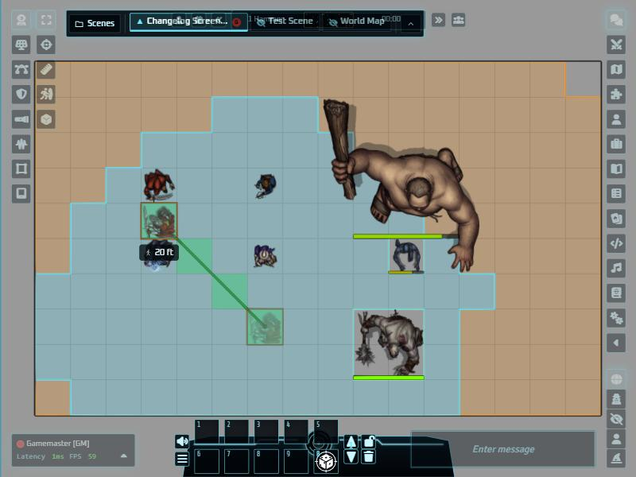
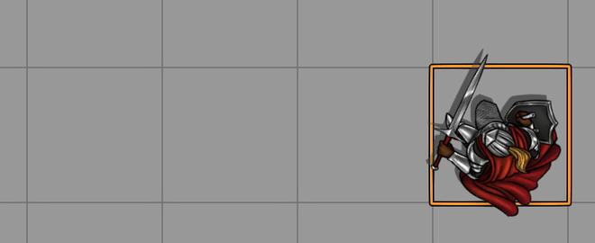
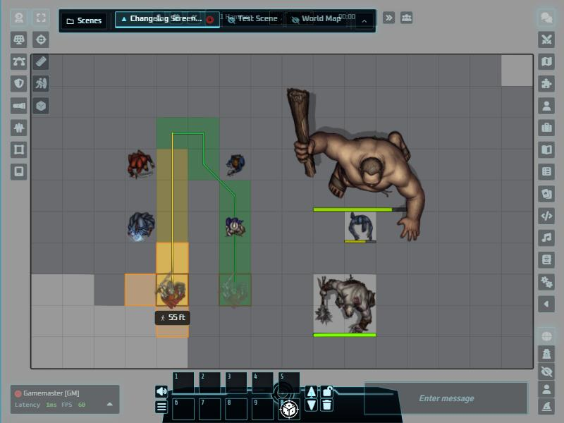
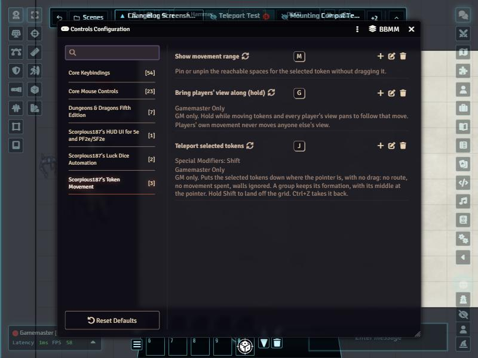
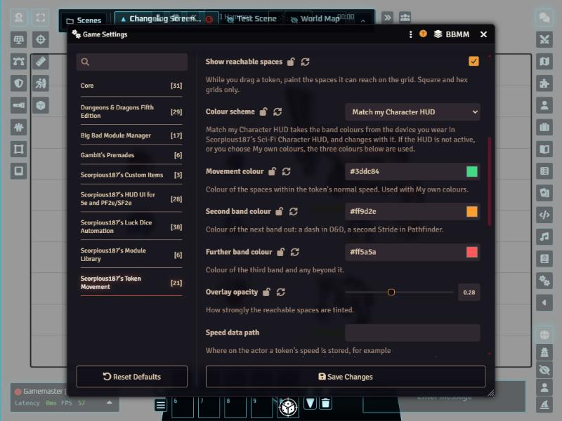
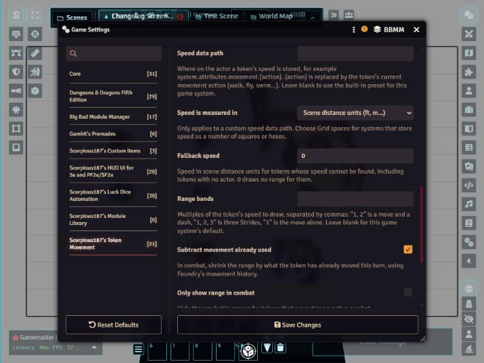

# Scorpious187's Token Movement

Makes moving a token feel like moving a miniature, on any game system, for Foundry VTT v14.

- **Lift and hop.** A moving token rises off the map, hops from space to space and lands. Or pick the glide: lift once, slide, set down.
- **Step sounds.** A soft footfall each time a token you can see lands on a space. Built-in sound, or your own file.
- **Reachable spaces.** While you drag a token, the spaces it can get to are painted on the grid in bands: its move, then a dash (or a second and third Stride in Pathfinder and Starfinder 2e).
- **A way round.** When the straight route is blocked, the cheapest route round is planned for you.
- **System-agnostic.** Speeds are read from a data path on the actor. Presets cover common systems; one setting covers the rest.
- **Your camera stays yours.** Nobody's movement moves anybody else's view. The one exception is a GM-only key the GM holds on purpose.
- **Matches your HUD.** With [Scorpious187's HUD UI](https://github.com/nscarpinatodev/scorpious187s-scifi-character-hud) active, the range takes its colours from the device you wear.





The same walk as video: [hop at real speed, with step sounds](docs/media/walk-hop.mp4), [hop at quarter speed](docs/media/walk-hop-slow.mp4), [glide](docs/media/walk-glide.mp4). The frames are captured from the game canvas at 60 fps; the step sounds in the first video are the module's own files, placed at the frames where it plays them.


Inspired by [Aeris Tokens](https://gitlab.com/aeris-fvtt/aeris-tokens) by Robin Chand, which targets v12–v13. This is an independent implementation for v14 that shares no code or assets with it.

## How it differs: it sits on top of core

Foundry v13 and v14 gained real token movement: waypoints, a ruler that shows the route to everyone, movement actions, terrain cost, and a per-turn movement history. This module does not replace any of it.

| You see | Who does it |
| --- | --- |
| The route line and distance labels while dragging | Core's token ruler (or your system's) |
| A route around a wall | This module. Core on its own draws a straight route and stops it at the wall |
| Other players seeing your planned move | Core |
| Whether a step is blocked, and what it costs | Core and your system, asked one step at a time |
| The lift, the hop, the footfall | This module |
| The painted reachable area | This module |

Because every step is priced and tested by asking the token itself, the painted area agrees with what the system will actually allow. In D&D 5e that means spaces held by enemies are left out, and terrain is costed by dnd5e's own cost function, with no D&D-specific code here. Players are only shown spaces they have seen, and a wall only blocks their overlay once they have seen it, the same rule core uses for its path preview.

Nothing is sent over a module socket. Each client already animates every move, so each plays its own hop and its own footsteps.

It also reads Foundry's settings rather than assuming them. The diagonal rule is whatever **Square Grid Diagonals** is set to in the core settings, including Alternating (1/2/1) and (2/1/2), and under those the count carries across a turn the way core's ruler counts it: if a token has already taken one diagonal this turn, the next one is priced as the second. Unconstrained movement and token auto-rotate are core's and are left alone.

## While you drag

When a drag starts, the overlay shows everything the token could reach. As you draw a route it follows along:

- It re-centres on the end of the route and shows what the movement you have left can still reach, in the same band colours. A band the route has used up drops out.
- Spaces that were reachable when the drag began but are not any more are dimmed, so you can see what this route costs you before you let go.
- Drag back to where you started and the full range returns. Drop or cancel and it clears.

The route's cost is core's own figure, the same one on the ruler label, so the two always agree: waypoints, difficult terrain, the diagonal rule and movement already used this turn are all in it.


On video: [the range following a drag](docs/media/live-drag.mp4).

## Finding a way round

Foundry has a hook for pathfinding but no pathfinder: left alone, a drag is a straight line that stops at the first wall. This module fills the hook in.

- If the straight route gets where you are dragging, it is used exactly as before. Nothing changes on open ground.
- If it is stopped short, the cheapest route round is searched for and its corners are added to the route as waypoints. The ruler, the cost and the live range all follow.
- "In the way" means whatever your game system says blocks a step, so in D&D 5e the route goes round enemies as well as walls.
- A player's route is only bent by walls they have seen, the same rule core applies to its own preview.
- If there is no way round within reach, you get core's answer: the route stops at the obstacle.
- Waypoints you place yourself are kept; each leg between them is routed on its own.

It can be switched off per user with **Find a way round**, which you will want if another module does your pathfinding. If such a module is already answering, this one stands aside.



On video: [dragging behind a wall and walking the route](docs/media/pathfinding.mp4). The wall line is drawn onto the video; walls are not visible on the token layer in play.

## Whose camera moves

A player moving a token never pans, zooms or otherwise pulls anyone else's view. There is no setting for it.

The GM has one tool: hold **G** while moving tokens and every player's view pans to follow that move, framing the whole group if several tokens moved together. Let go and moves are private again.

- The key is GM-only in Foundry's Controls and cannot be bound or triggered by a player.
- Each client checks that the move really came from a GM before following. A player who forged the request would be ignored.
- Hidden tokens are never followed, so the GM can hold the key through a mixed move without revealing anything.
- The GM's own view is not moved.

## Requirements

- Foundry VTT v14
- [Scorpious187's Module Library](https://github.com/nscarpinatodev/scorpious187s-lib)

No libWrapper or socketlib needed.

## Speeds

The range overlay needs to know how fast a token is. Out of the box:

| System | Reads | Bands |
| --- | --- | --- |
| D&D 5e (`dnd5e`) | `system.attributes.movement.speeds.{action}` | move, dash |
| Pathfinder 2e (`pf2e`), Starfinder 2e (`sf2e`) | `system.movement.speeds.{action}` | 1, 2, 3 Strides |
| Pathfinder 1e (`pf1`), 3.5e (`D35E`) | `system.attributes.speed.{action}.total` | move, dash |
| Starfinder 1e (`sfrpg`) | `system.attributes.speed.{action}.value` | move, dash |
| Level Up A5E (`a5e`) | `system.attributes.movement.{action}.distance` | move, dash |
| Savage Worlds (`swade`) | `system.pace` (in grid spaces) | move, dash |

`{action}` is the token's current movement action (walk, fly, swim…). If the token has no speed for that action, its walking speed is used. The dnd5e, pf2e, sf2e and D35E paths were checked against the installed systems; the others follow each system's published data model.

For any other system, set **Speed data path** in the module settings, and **Speed is measured in** if the system counts in squares rather than feet or metres. **Fallback speed** covers tokens with no actor.

In combat, the range shrinks by what the token has already moved this turn, using core's movement history.

## Controls

- **Drag a token** to see its range. It clears when you drop or cancel.
- **M** (rebindable) pins or unpins the range of the selected token without dragging. A pinned range follows the token and redraws when walls, turns or settings change.
- **G** (GM only, hold, rebindable) brings every player's view along with the tokens you move.



## Colours

By default the range matches your Character HUD. The nearest band uses the device's main colour, the second its accent and the third its warning colour, and the range re-colours the moment you change device. The colours are read from the HUD at draw time, so new devices and looks need nothing from this module.

If the HUD is not active, or you pick **My own colours**, the three colour pickers apply instead.


## Settings

Per user: find a way round (pathfinding) on or off, animation style (hop, glide, or Foundry default), lift height and zoom, step sounds on or off and their volume (they play on Foundry's Interface audio channel), whether to show reachable spaces, colour scheme, band colours and opacity.

Per world: walk speed (how fast tokens travel, in spaces per second; Foundry's own is 6), custom step sound, speed data path and unit, fallback speed, range bands (for example `1, 2, 3`), subtract movement already used, only show in combat, and the largest range to draw.






## For module and system authors

```js
// Replace the bands for a token. Distances are in scene units.
Hooks.on('scorpious187s-token-movement.getMovementRanges', (tokenDocument, action, ranges) => {
  if (tokenDocument.actor?.statuses.has('grappled')) ranges.push({ distance: 5, color: 0xff0000 });
});

// Fired on every client each time an animated token lands on a space.
Hooks.on('scorpious187s-token-movement.step', (token, index) => {});

const api = game.modules.get('scorpious187s-token-movement').api;
api.getSpeed(token, 'walk');          // scene units, 0 if unknown
api.getMovementRanges(token, 'walk'); // [{distance, color, alpha}]
api.pinRange(token);                  // or api.pinRange() to unpin
api.refreshRange();
```

Flying, swimming, burrowing and driving glide rather than hop and make no footsteps. Teleports and unmeasured movement (a rider carried by [Token Mounting](https://github.com/nscarpinatodev/scorpious187s-token-mounting), a displacement) are left alone.

## Not yet

- Gridless scenes get the animation but no range overlay.
- Pathfinding is planned on the flat: a leg that changes elevation is left as core's straight line.
- Other players do not see your overlay, only core's ruler.
- No drop shadow under a lifted token.

## Development

```
node tools/check.mjs        # manifest, strings, and the range search against Foundry's own grid maths
node tools/gen-sounds.mjs   # regenerate the built-in step sounds (synthesised, no third-party audio)
```

`check.mjs` imports the real grid classes from a local Foundry v14 install when it finds one and compares every space within range against `grid.measurePath`, for each diagonal rule and each hex layout.

Releases are cut by pushing a `v*` tag; the workflow stamps `module.json` from the tag and publishes `module.json` and `module.zip`.
